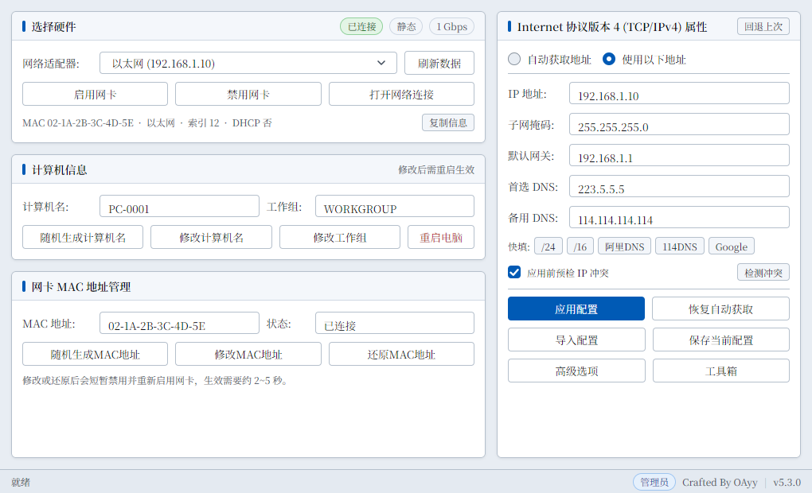
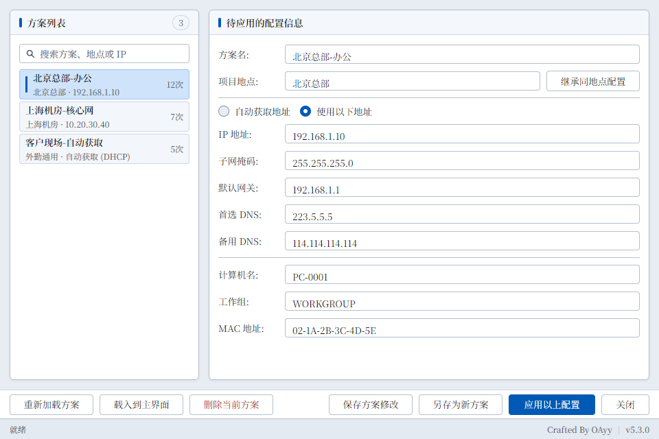
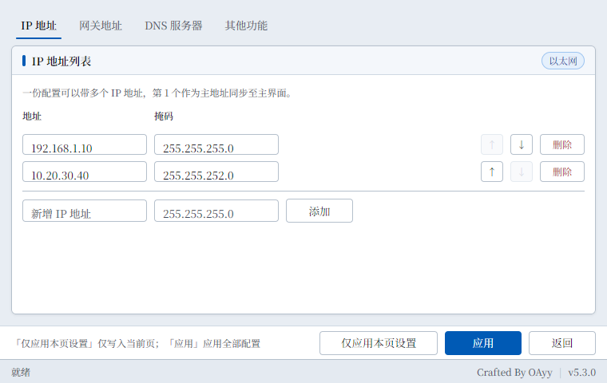
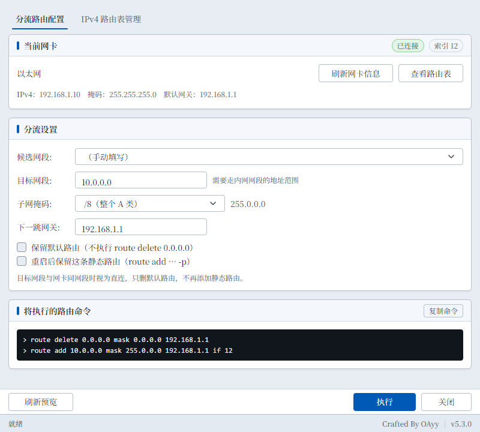
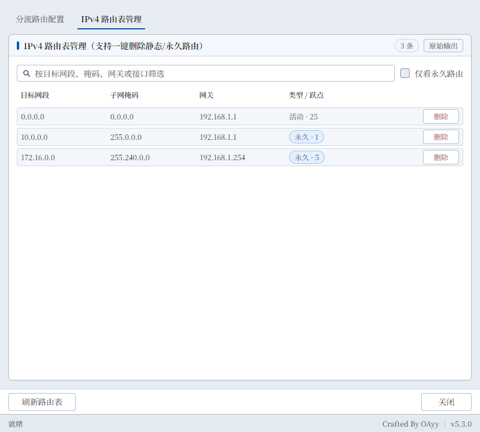
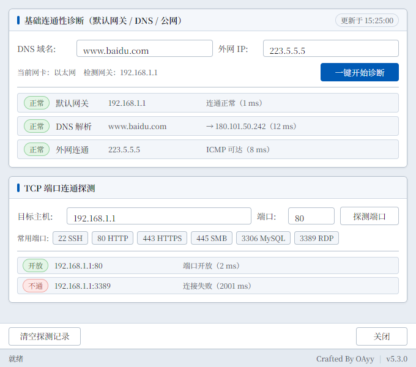
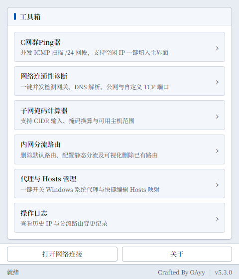
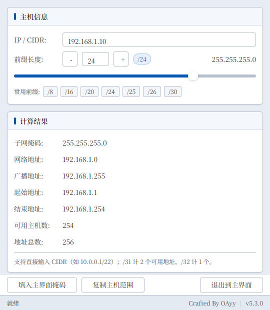
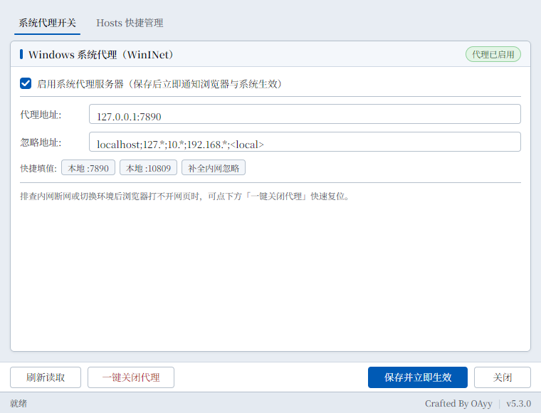
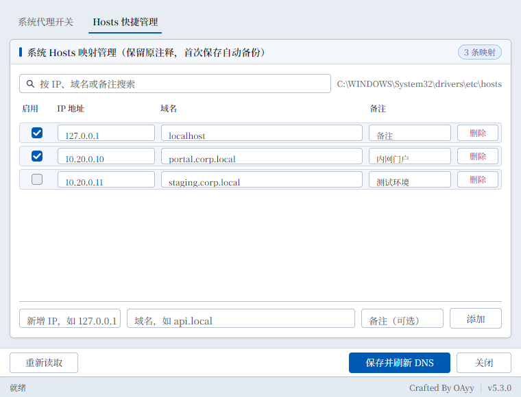

<div align="center">


# NetShift

**轻量、原生、高对比度的 Windows 网络配置与现场运维工具箱**

[](mygo.json)
[](go.mod)
[](https://github.com/egoist/mygo)
[](#构建与运行)

[核心特点](#核心特点) · [实测截图](#实测截图) · [功能清单](#功能清单) · [构建与运行](#构建与运行) · [目录结构](#目录结构) · [与原版差异](#与原版差异) · [致谢](#致谢)

</div>

---

**NetShift**（网络配置工具箱）灵感源于 **kn007《IP 地址修改器 5.0 重制版》**，采用 Go 1.27 + [mygo](https://github.com/egoist/mygo) 原生 GPU 渲染 UI 从零构建，融合现场运维脚本 `mulNetworkTest.bat` 的**项目地点继承、内网分流路由与操作审计日志**，并扩展了 **IP 冲突预检、修改前自动快照回退、网络连通性诊断、可视化路由表管理、Windows 系统代理与 Hosts 快捷管理、以及系统托盘极速切换**等能力。

- 当前版本：`v5.3.0`

---

## 核心特点

- **原生 GPU 渲染，轻量免运行时**：基于 Go + `mygo` 原生桌面框架，无 Electron / WebView 内存负担，直接调用 Win32 API（`GetAdaptersAddresses`、`SendARP`、`IcmpSendEcho`、`WinINet`）与隐藏窗口系统命令，无需安装额外运行时。
- **修改前防错与一键回退**：应用静态 IP 前自动执行 **ARP + ICMP 双重冲突预检**（自动过滤本机全部网卡 MAC，避免误报）；写入配置前自动捕获当前网卡快照，切换失败或误操作时可点击「回退上次」一键恢复。
- **面向多现场的方案与分流能力**：预设方案按「项目地点」管理并支持一键继承同地点的掩码/网关/DNS；内置「内网分流路由」专治有线内网 + Wi-Fi 上网双网卡冲突，支持直连判定、命令实时预览以及结构化 IPv4 路由表筛选与一键删除。
- **一站式排障工具箱**：内置 254 主机并发 ICMP 群 Ping（选中空闲主机可一键填入主界面静态 IP）、网关/DNS/外网/自定义 TCP 端口并发诊断、CIDR 子网掩码计算器、WinINet 系统代理一键开关与 Hosts 可视化管理（自动保留原注释并首次备份）。
- **系统托盘极速切换**：常驻通知区域，右键即可查看当前网卡、一键切换常用预设方案（最多展示前 8 项）、恢复 DHCP 或直达连通性诊断与代理/Hosts 管理。
- **高对比度排版与全窗口自适应**：采用全新深曜石极简图标、思源宋体高对比度 Fluent 网格视觉规范，开启 Per-Monitor-v2 DPI 感知；主窗口与全部子窗口按屏幕工作区与网卡名长度自动适配，125%–200% 缩放下文字清晰不模糊、窗口不溢出。
- **平滑迁移与审计可追溯**：首次启动自动检测并导入 `mulNetworkTest.bat` 的 `ip_history.txt`（备份原文件为 `ip_history.<时间>.txt`）；每次 IP 变更与分流路由操作均按标准格式追加记录至 `network_config.log`。

---

## 实测截图

> 以下截图均在 Windows 11 x64（Go 1.27.3）环境下通过实测编译与全量测试生成（版本 `v5.3.0`）。

### 主窗口

集成网卡管理、计算机名/工作组修改、MAC 地址管理、IPv4 静态/DHCP 配置、掩码与常用 DNS 快填、IP 冲突预检及一键回退快照。

<div align="center">
  
</div>

### 预设方案与高级选项

| 预设配置方案（地点分组与同地点继承） | 高级选项（多 IP / 多网关 / 多 DNS / 跃点数） |
| :---: | :---: |
|  |  |

### 内网分流路由与路由表管理

| 分流路由配置与命令实时预览 | 结构化 IPv4 路由表筛选与一键删除 |
| :---: | :---: |
|  |  |

### 网络诊断、C 网群 Ping 与子网计算

| 网络连通性诊断（网关 / DNS / 外网 / TCP 端口） | C 网群 Ping 器（空闲 IP 一键填入主界面） |
| :---: | :---: |
|  |  |

| 工具箱总览 | 子网掩码计算器（CIDR 实时换算） |
| :---: | :---: |
|  |  |

### Windows 系统代理与 Hosts 快捷管理

| 系统代理开关（WinINet 即时广播生效） | Hosts 快捷管理（勾选启停 / 搜索 / 自动备份） |
| :---: | :---: |
|  |  |

---

## 功能清单

### 主窗口与系统托盘

| 模块 | 功能说明 |
|---|---|
| **选择硬件** | 网卡下拉（名称 + 当前 IP）、连接状态/DHCP/链路速率徽章、启用/禁用网卡、刷新数据、打开网络连接；显示 MAC/类型/接口索引/DHCP，并支持一键「复制信息」 |
| **计算机信息** | 查看与修改计算机名、工作组，随机生成计算机名，提供带二次确认的「重启电脑」操作（修改后需重启生效） |
| **MAC 地址管理** | 显示当前 MAC、生成合法本地管理单播 MAC、修改与还原 MAC（写入注册表 `NetworkAddress` 后自动禁用并重启用网卡） |
| **IPv4 属性** | 自动获取 (DHCP) / 使用以下地址（IP、掩码、网关、首选/备用 DNS）；内置 `/24`、`/16`、阿里 DNS、114 DNS、Google DNS 快填；支持「应用前预检 IP 冲突」与手动「检测冲突」；支持「回退上次」快照恢复 |
| **系统托盘** | 显示当前网卡、点击图标唤起主窗口、快捷切换前 8 个预设方案、一键恢复 DHCP、快速打开连通性诊断与代理/Hosts 管理 |

### 高级选项（4 个标签页）

- **IP 地址**：为同一网卡配置多组 `IP + 子网掩码`，支持增删与上下排序，第 1 条自动同步主界面。
- **网关地址**：配置多组默认网关与跃点数（支持留空由系统自动决定），支持增删排序。
- **DNS 服务器**：管理多条 DNS 地址并按顺序写入（第 1 条首选，其余备用）。
- **其他功能**：适配器跃点数（自动 / 1–9999 自定义）、释放 IP（`ipconfig /release`）、更新 IP（`ipconfig /renew`）、清除 DNS 缓存（`ipconfig /flushdns`）；支持「仅应用本页设置」或「应用全部配置」。

### 预设配置方案（`ip.dat`）

- 方案保存、原位改名、另存为新方案、删除、重新加载、载入到主界面、一键应用；支持按方案名、地点、IP、网关、计算机名实时搜索。
- **项目地点继承**：同一项目地点已有方案时，点击「继承同地点配置」自动复用该地点最高频方案的掩码/网关/DNS，仅需修改主机 IP。
- **历史兼容**：首次启动若目录下无 `ip.dat` 但存在 `mulNetworkTest.bat` 生成的 `ip_history.txt`，自动解析导入并备份原文件。

### 工具箱（6 项独立工具）

| 工具 | 核心能力 |
|---|---|
| **C 网群 Ping 器** | 使用 Win32 `IcmpSendEcho` 并发探测 `x.x.x.1–254`（无外部进程），可调并发数与超时；绿/灰/白三态网格、悬停显示 RTT、点击主机号单点重测并可一键「设为静态 IP」填入主界面，支持复制全部在线 IP |
| **网络连通性诊断** | 一键并发检测默认网关（ICMP）、DNS 域名解析、公网可达性（ICMP 优先，失败自动回退 TCP:53）；支持自定义主机与端口 TCP 连通探测，提供 `22/80/443/445/3306/3389` 快捷按钮 |
| **子网掩码计算器** | 支持直接输入 IP 或 CIDR（如 `10.0.0.1/22`）、前缀滑杆与 `-`/`+` 微调、`/8 /16 /20 /24 /25 /26 /30` 常用快选；实时输出子网掩码、网络/广播/起止地址、可用主机数与地址总数，支持「填入主界面掩码」与「复制主机范围」 |
| **内网分流路由** | 针对双网卡环境，删除默认路由 `0.0.0.0/0` 并按目标网段添加静态路由（可选 `-p` 持久化）；目标网段与网卡同网段时自动按直连处理；内置「IPv4 路由表管理」标签页，支持关键词筛选、仅看永久路由、一键删除单条路由及查看/复制 `route print -4` 原始输出 |
| **代理与 Hosts 管理** | **系统代理**：读写 HKCU `Internet Settings` 并调用 `InternetSetOptionW` 广播刷新，支持本地 `:7890`/`:10809` 与内网忽略列表快填及「一键关闭代理」；**Hosts 管理**：结构化展示与搜索系统 `hosts`、复选框快速启用/注释、增删条目、保留原注释，首次保存自动备份，保存后自动刷新 DNS 缓存 |
| **操作日志** | 深色等宽日志视图查看 `network_config.log`，支持刷新与一键复制全部日志 |

---

## 界面与排版设计

视觉定位为 **高对比度 Windows 11 Fluent 实用工具**，所有文本配色均满足 WCAG AA/AAA 对比度标准：

| 规范项 | 配置值 |
|---|---|
| **网格与圆角** | 基准单位 `4 DIP`；窗口边距 `14`、列间距 `14`、行间距 `9`、卡片内边距 `13`；表单行高/按钮高 `30`、状态栏高 `30`；卡片圆角 `6`、控件圆角 `4` |
| **字体与字重** | 界面字体 `Noto Serif SC, Source Han Serif SC, 思源宋体, SimSun, Microsoft YaHei UI, serif`（正文 `13.5` / 标题 `14` / 辅助 `12`，统一 `400` 与 `600` 两级字重）；命令行与日志使用 `Consolas, Courier New, monospace` |
| **色彩令牌** | 画布 `#E8EDF3`、卡片 `#FFFFFF`、边框 `#B5C0CC`、主文字 `#0B0F14`、标签 `#1F2937`、弱化文字 `#424D5C`、主题强调色 `#005AB5` |
| **DPI 与自适应** | 启动时启用 Per-Monitor-v2 DPI 感知；所有窗口根据 `GetDpiForSystem` + `SPI_GETWORKAREA` 动态钳制在屏幕工作区内，防止高缩放屏截断 |

---

## 构建与运行

### 环境要求

- 操作系统：Windows 10 / Windows 11（x64）
- Go 工具链：`Go 1.27.3` 或更高版本
- 权限要求：修改网卡 IP/DNS/MAC、路由表、计算机名、工作组与系统 `hosts` 均需要管理员权限（程序启动时会自动检测并触发 UAC 提权）

### 常用命令

```powershell
# 如需离线使用本机模块缓存，可保留前两行环境变量；允许联网拉取依赖时可省略
$env:GOPROXY = 'off'
$env:GOSUMDB = 'off'
$env:GOFLAGS = '-mod=mod'

# 1. 编译全部包
go build ./...

# 2. 运行全部单元测试与 UI 视图测试（共 11 个测试包）
go test -count=1 ./...

# 3. mygo 构建期检查
go tool mygo vet .

# 4. 打包独立可执行文件与 NSIS 安装包（输出至 build/windows-amd64/）
go tool mygo build
```

打包产物位于 `build/windows-amd64/`：

```text
build/windows-amd64/netshift.exe                      独立可执行文件
build/windows-amd64/netshift-setup-5.3.0-amd64.exe    NSIS 安装包
```

### 调试与验证开关

```powershell
# 开发期跳过 UAC 自动提权（以标准权限启动界面预览）
$env:NETSHIFT_NO_ELEVATE = '1'; .\build\windows-amd64\netshift.exe

# 只读实测本机真实网卡枚举（GetAdaptersAddresses）
$env:NETSHIFT_LIVE = '1'; go test -count=1 -run TestLiveAdapters -v ./internal/netcfg

# 离线渲染全窗口 UI 截图到指定目录
$env:NETSHIFT_SHOTS = (Resolve-Path .tmp\shots).Path; go test -count=1 -run TestCaptureFrames -v ./internal/ui
```

### 运行时注意事项

- 程序使用命名互斥锁 `Local\NetShiftNativeUI` 保证单实例运行。
- 所有系统命令行工具通过隐藏窗口执行，控制台输出按当前系统 OEM 代码页（中文 Windows 为 CP936/GBK）自动转换为 UTF-8。
- 配置文件 `ip.dat` 与审计日志 `network_config.log` 默认保存在可执行文件同级目录；首次保存系统 `hosts` 时会自动生成 `.netshift.bak` 备份。

---

## 目录结构

```text
netshift/
├── main.go                   程序入口：DPI 感知、单实例互斥、UAC 提权、主窗口与托盘初始化
├── mygo.json                 mygo 应用元数据与打包配置（v5.3.0）
├── go.mod / go.sum           Go 模块与依赖声明（module netshift）
├── docs/
│   └── images/               README 界面截图
└── internal/
    ├── assets/               应用内嵌图标（深曜石极简蓝光节点图标 icon.png）
    ├── hostsys/              计算机名与工作组读写、随机主机名生成、重启控制
    ├── macaddr/              MAC 读取、随机单播生成、注册表 NetworkAddress 修改与还原
    ├── model/                配置方案 Profile、地址/掩码/跃点校验等纯逻辑模型
    ├── netcfg/               Win32 网卡枚举（GetAdaptersAddresses）、netsh 应用与 IP/DNS 维护
    ├── netdiag/              SendARP + ICMP 冲突预检、网关/DNS/外网并发诊断与 TCP 端口探测
    ├── pingfan/              基于 Win32 IcmpSendEcho 的无进程并发群 Ping
    ├── routing/              内网分流路由命令构建、直连判定、route print -4 解析与单条删除
    ├── store/                自研零依赖 INI 读写（ip.dat）、ip_history.txt 迁移与操作日志
    ├── subnet/               CIDR 与子网掩码计算
    ├── sysnet/               WinINet 系统代理注册表读写与广播、Hosts 结构化解析与备份保存
    └── ui/                   全部 mygo 原生视图、状态管理、托盘菜单与自动化布局/截图测试
```

---

## 与原版差异

| 对比项 | 原版（IP 地址修改器 5.0 重制版） | NetShift（v5.3.0） |
|---|---|---|
| **架构与位数** | AutoIt3 编译脚本（UPX 压缩，32 位） | 原生 Go 1.27 + mygo GPU 渲染（原生 x64） |
| **界面与图标** | 固定像素 Win32 表单（706×369）与旧版图标 | 响应式 Fluent 网格、思源宋体高对比度排版、Per-Monitor-v2 DPI 自适应、全新深曜石极简图标 |
| **网卡与底层调用** | 依赖 WMI COM 与多处外部调用 | 纯 Win32 `GetAdaptersAddresses` / `SendARP` / `IcmpSendEcho` / `WinINet` + 规范化 `netsh` |
| **配置文件格式** | `ip.dat`（INI 结构，键名被混淆） | `ip.dat`（人类可读 INI 键名），新增 `Location` / `Adapter` / `DHCP` / `Usage` / `UpdatedAt`，兼容导入 `ip_history.txt` |
| **防错与回退** | 直接写入，无冲突预检与快照回退 | 应用前 ARP + ICMP 冲突预检 + 修改前自动快照一键回退 |
| **运维扩展工具** | 子网计算器、C 网群 Ping | 新增内网分流路由与可视化路由表管理、连通性诊断与 TCP 端口探测、系统代理开关、Hosts 管理、操作日志、系统托盘快捷切换 |
| **提权方式** | PE 清单 `requireAdministrator` | 启动时自检权限，未提权则通过 `ShellExecute runas` 自动提权重启（开发期支持 `NETSHIFT_NO_ELEVATE=1` 跳过） |
| **高级选项局部生效** | 网关页提供 `AC` 快捷按钮 | 统一提供「仅应用本页设置」与「应用」两个明确操作 |

---

## 致谢

- **[kn007](https://kn007.net)**：原版《IP 地址修改器 5.0 重制版》的原作者。本项目在核心交互流程、多网卡与高级选项设计上均以原版为蓝本复刻并致敬。
- **`mulNetworkTest.bat` 现场运维脚本**：贡献了贴近真实多网段工程现场的项目地点继承、历史配置管理、双网卡内网分流路由与操作日志规范。
- **[mygo](https://github.com/egoist/mygo)**（egoist）：提供优雅、轻量的 Go 原生 GPU 渲染 UI 与 Windows 系统托盘框架。
- **Go 团队与开源生态**：感谢 Go 语言标准库及 `golang.org/x/sys`、`golang.org/x/text` 等基础库的支持。
- **思源宋体（Source Han Serif / Noto Serif SC）**：感谢 Adobe 与 Google 联合开源的高可读性中文字体家族。

---

<div align="center">
  Crafted By <strong>OAyy</strong> · Original Inspiration By <strong>kn007</strong>
</div>
