<div align="center">


# NetShift

**A Lightweight, Native, High-Contrast Windows Network Configuration & Field Operations Toolbox**

[简体中文](README.md) | English

[](mygo.json)
[](go.mod)
[](https://github.com/egoist/mygo)
[](#build-and-run)

[Key Features](#key-features) · [Screenshots](#screenshots) · [Feature Overview](#feature-overview) · [Build and Run](#build-and-run) · [Project Structure](#project-structure) · [Comparison](#comparison-with-the-original) · [Acknowledgements](#acknowledgements)

</div>

---

**NetShift** is inspired by **kn007's IP Address Modifier 5.0 Remastered**, rebuilt from scratch in Go 1.27 with [mygo](https://github.com/egoist/mygo) native GPU-rendered UI. It integrates the field-engineering workflow of `mulNetworkTest.bat` (**site-based profile inheritance, intranet split routing, and audit logging**) and extends it with **IP conflict pre-checks, automatic pre-change snapshot rollback, connectivity diagnostics, structured IPv4 route management, Windows system proxy & Hosts editing, and quick system-tray switching**.

- Current Version: `v0.1.0`

---

## Key Features

- **Native GPU Rendering, Zero Runtime Overhead**: Built with Go and `mygo` (no Electron or WebView). Calls native Win32 APIs (`GetAdaptersAddresses`, `SendARP`, `IcmpSendEcho`, `WinINet`) and hidden system commands directly, shipping as a standalone executable.
- **Pre-Apply Safety & One-Click Rollback**: Automatically performs **ARP + ICMP dual IP conflict pre-check** before writing a static IP (filtering out all local NIC MAC addresses to prevent false positives). Automatically captures a live adapter snapshot before applying changes so you can recover in one click via **Rollback Last**.
- **Multi-Site Presets & Split Routing**: Organizes saved profiles by **Site / Location** with one-click inheritance of mask, gateway, and DNS from the most-used profile at the same site. Built-in **Split Routing** resolves dual-NIC conflicts (wired intranet + Wi-Fi internet) with direct-subnet detection, real-time command preview, and structured IPv4 route filtering & deletion.
- **All-in-One Diagnostics & Operations Toolbox**: Includes a 254-host concurrent ICMP C-class ping scanner (click any free host to fill it directly into the main static IP form), concurrent Gateway/DNS/Internet/TCP-port diagnostics, CIDR subnet mask calculator, WinINet system proxy toggle, and visual `hosts` editor (preserves original comments and creates an automatic backup on first save).
- **System Tray Quick Switching**: Stays in the Windows notification area to display the active NIC, switch between up to 8 saved profiles, restore DHCP, or jump directly to Connectivity Diagnostics and Proxy/Hosts Manager.
- **High-Contrast Typography & Adaptive Windows**: Features a minimalist obsidian-node icon, high-contrast Fluent grid tuned for Source Han Serif SC (`500 Medium / 700 Bold`), vertically centered single-line text & search inputs, and Per-Monitor-v2 DPI awareness. All windows automatically fit within the display work area across 125%–200% scaling without blur or clipping.
- **Legacy Migration & Traceable Audit Logs**: Automatically imports `ip_history.txt` from `mulNetworkTest.bat` on first launch (backing up the original file as `ip_history.<timestamp>.txt`), and appends every IP and split-route operation to `network_config.log`.

---

## Screenshots

> All screenshots below were generated on Windows 11 x64 (Go 1.27.3) with full tests passing (version `v0.1.0`).

### Main Window

Unified control over adapter selection, computer name/workgroup, MAC address management, IPv4 DHCP/static settings, quick mask & DNS chips, IP conflict pre-check, and one-click snapshot rollback.

<div align="center">
  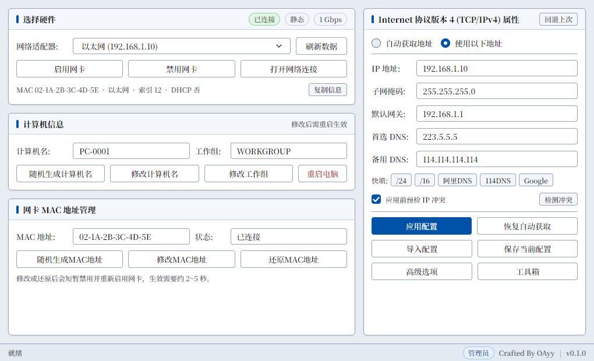
</div>

### Presets Manager & Advanced Options

| Presets Manager (Location Grouping & Site Inheritance) | Advanced Options (Multi-IP / Gateway / DNS / Metric) |
| :---: | :---: |
| 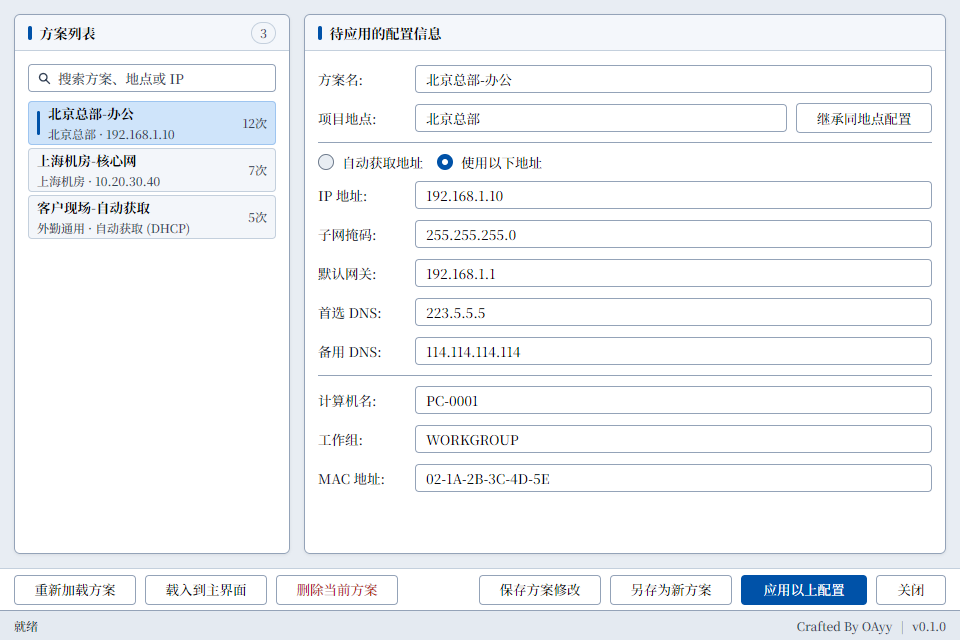 | 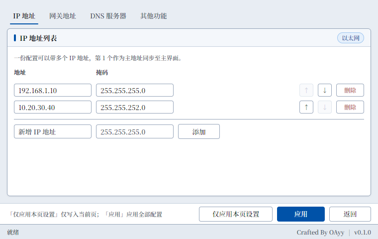 |

### Split Routing & IPv4 Route Table Manager

| Split Routing Setup & Command Preview | Structured IPv4 Route Filtering & One-Click Delete |
| :---: | :---: |
| 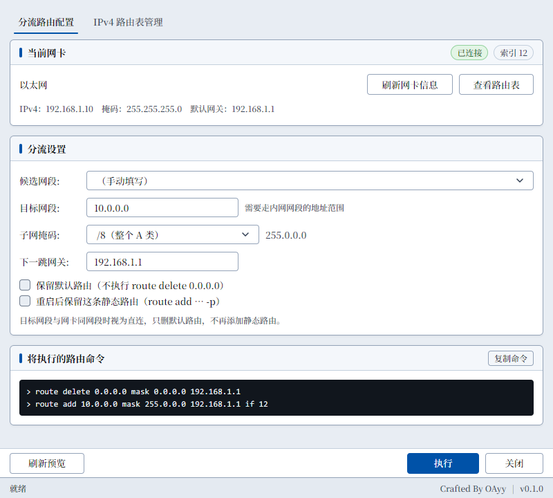 | 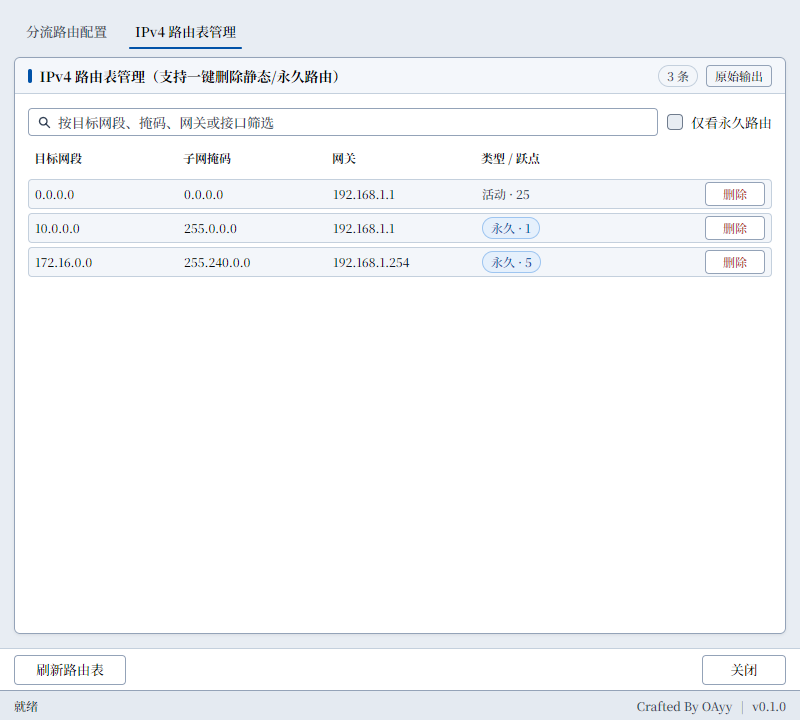 |

### Network Diagnostics, C-Class Ping & Subnet Calculator

| Connectivity Diagnostics (Gateway / DNS / Internet / TCP) | C-Class Ping Scanner (Fill Free IP to Main Form) |
| :---: | :---: |
| 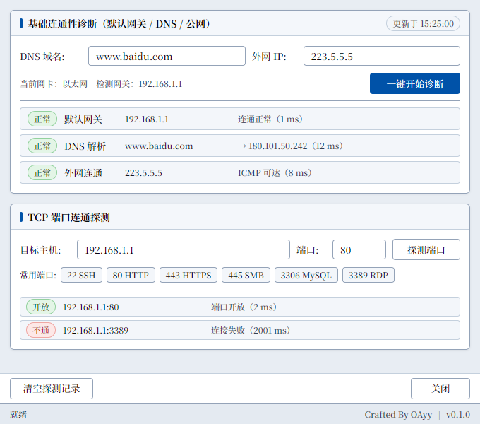 | 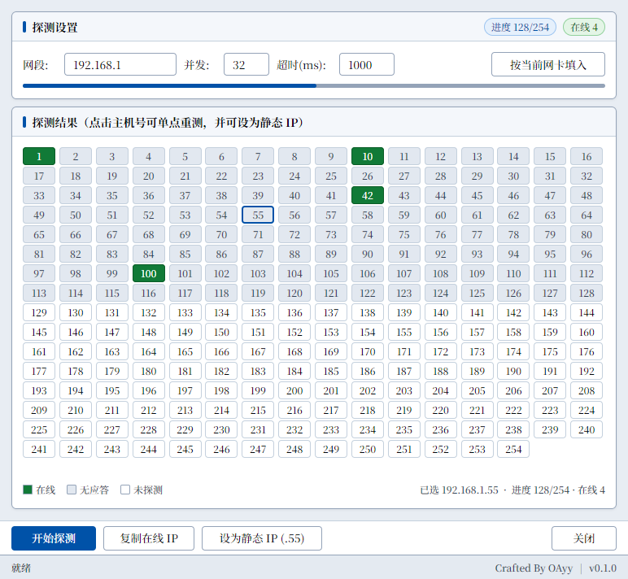 |

| Toolbox Overview | Subnet Mask Calculator (Real-Time CIDR) |
| :---: | :---: |
| 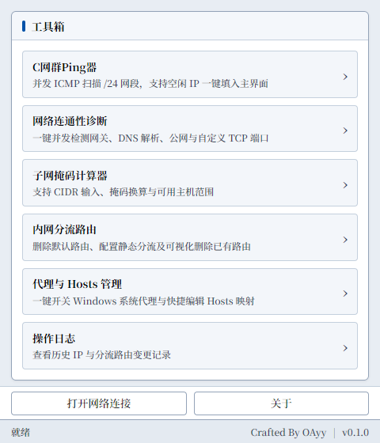 | 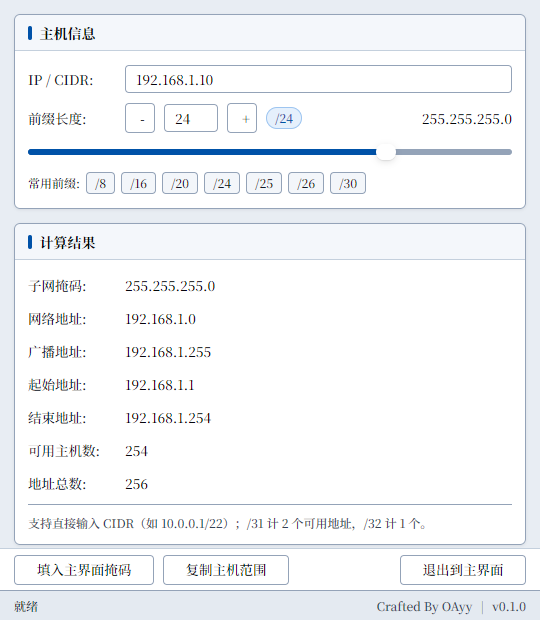 |

### Windows System Proxy & Hosts Manager

| System Proxy Toggle (Immediate WinINet Broadcast) | Visual Hosts Manager (Toggle / Search / Auto Backup) |
| :---: | :---: |
| 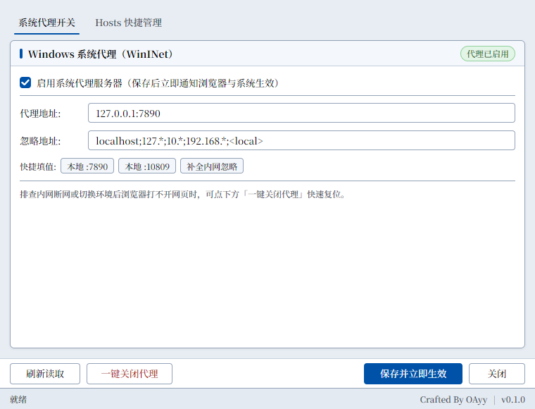 | 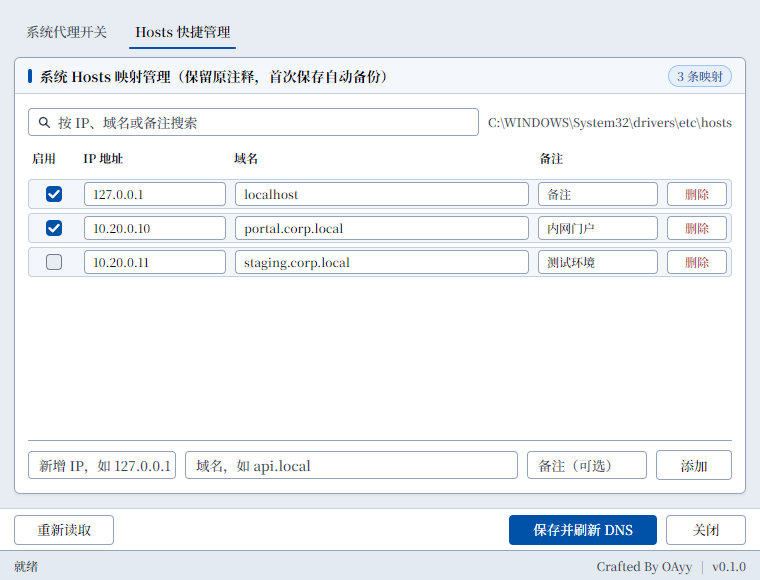 |

---

## Feature Overview

### Main Window & System Tray

| Section | Capabilities |
|---|---|
| **Adapter Selection** | Adapter dropdown (name + current IP), status/DHCP/link-speed badges, Enable/Disable NIC, Refresh, Open Network Connections (`ncpa.cpl`); displays MAC, adapter type, interface index, DHCP flag, and one-click summary copy |
| **Computer Info** | View and update Computer Name and Workgroup, generate random hostnames, and reboot computer with confirmation dialog (takes effect after restart) |
| **MAC Address Manager** | Inspect current MAC, generate valid locally administered unicast MACs, apply or restore MAC (writes registry `NetworkAddress` and cycles the adapter automatically) |
| **IPv4 Properties** | Obtain automatically (DHCP) or static IP/Mask/Gateway/Primary & Secondary DNS; quick chips for `/24`, `/16`, AliDNS, 114DNS, and Google DNS; pre-apply & manual IP conflict check; one-click **Rollback Last** snapshot restore |
| **System Tray** | Shows active adapter, clicks to restore main window, quick-switches up to 8 saved presets, restores DHCP, and launches Diagnostics or Proxy/Hosts Manager |

### Advanced Options (4 Tabs)

- **IP Addresses**: Multiple `IP + Subnet Mask` pairs per adapter with add, delete, and reorder controls (entry #1 syncs with the main window).
- **Gateways**: Multiple default gateways with optional custom metrics and ordering.
- **DNS Servers**: Ordered list of DNS servers (entry #1 as primary, remaining as alternates).
- **Other**: Interface metric (`Auto` or `1–9999`), Release IP (`ipconfig /release`), Renew IP (`ipconfig /renew`), Flush DNS cache (`ipconfig /flushdns`); supports both **Apply This Tab Only** and **Apply All**.

### Presets Manager (`ip.dat`)

- Save, rename in place, save as new, delete, reload, load into main form, or apply immediately; real-time search across profile name, site location, IP, gateway, and computer name.
- **Site Inheritance**: Click **Inherit Same-Site Settings** to reuse the mask, gateway, and DNS from the most-used profile at the same site while keeping or editing your host IP.
- **Legacy Import**: Automatically imports `ip_history.txt` created by `mulNetworkTest.bat` when `ip.dat` does not yet exist, preserving a timestamped backup.

### Toolbox (6 Built-in Utilities)

| Utility | Highlights |
|---|---|
| **C-Class Ping Scanner** | In-process concurrent `IcmpSendEcho` scan across `x.x.x.1–254` with tunable workers and timeout; 3-state grid (online / offline / pending), hover RTT tooltip, click-to-reprobe single host, one-click **Set as Static IP**, and copy all online IPs |
| **Connectivity Diagnostics** | Concurrent checks for Default Gateway (ICMP), DNS resolution, and Public Internet (ICMP with automatic TCP:53 fallback); custom host + TCP port tester with quick chips for `22 / 80 / 443 / 445 / 3306 / 3389` |
| **Subnet Mask Calculator** | Supports IP or direct CIDR input (e.g. `10.0.0.1/22`), prefix slider with `-`/`+` buttons, and `/8 /16 /20 /24 /25 /26 /30` quick chips; computes mask, network, broadcast, usable host range, usable count, and total addresses; one-click fill mask to main form or copy range |
| **Intranet Split Routing** | Removes default route `0.0.0.0/0` and adds targeted static routes (optional `-p` persistent) for dual-NIC setups; handles direct-connected subnets automatically; includes a structured **IPv4 Route Table Manager** tab with search, persistent-only filter, one-click route deletion, and raw `route print -4` view/copy |
| **Proxy & Hosts Manager** | **System Proxy**: Reads/writes HKCU `Internet Settings` and broadcasts `InternetSetOptionW` so browsers pick up changes immediately, with `:7890`/`:10809`/LAN-bypass chips and one-click disable; **Hosts Manager**: Structured list with search, checkbox enable/disable, add/delete rows, comment preservation, automatic `.netshift.bak` backup, and automatic DNS flush on save |
| **Operation Log** | Monospace dark console viewer for `network_config.log` with refresh and copy-all actions |

---

## UI & Typography Design

Designed as a **high-contrast Windows 11 Fluent utility** with text contrast exceeding WCAG AA/AAA standards:

| Token | Specification |
|---|---|
| **Grid & Alignment** | `4 DIP` base unit; window padding `14`, column gap `14`, row gap `9`, card padding `13`; form row & button height `30`, status bar height `30`; card radius `6`, control radius `4`; zero vertical padding on single-line inputs & search fields for exact vertical text centering |
| **Typography** | UI font stack `Noto Serif SC, Source Han Serif SC, 思源宋体, SimSun, Microsoft YaHei UI, serif` (`13.5` body / `14` heading / `12` hint; two weights: `500 Medium` and `700 Bold`); console & logs use `Consolas, Courier New, monospace` |
| **Color Palette** | Canvas `#E8EDF3`, Card `#FFFFFF`, Border `#94A3B8`, Primary Text `#05080D`, Label `#111827`, Muted Text `#334155`, Accent `#0052A8` |
| **DPI & Sizing** | Enables Per-Monitor-v2 DPI awareness at startup; all windows dynamically clamp to `GetDpiForSystem` + `SPI_GETWORKAREA` so dialogs never clip on high-DPI displays |

---

## Build and Run

### Requirements

- OS: Windows 10 / Windows 11 (`x64`)
- Toolchain: `Go 1.27.3` or newer
- Privileges: Modifying NIC IP/DNS/MAC, routes, hostname, workgroup, and system `hosts` requires Administrator rights (NetShift automatically prompts for UAC elevation at startup)

### Commands

```powershell
# Optional: keep the first two lines when building offline from local module cache
$env:GOPROXY = 'off'
$env:GOSUMDB = 'off'
$env:GOFLAGS = '-mod=mod'

# 1. Compile all packages
go build ./...

# 2. Run all unit and UI view tests (11 test packages)
go test -count=1 ./...

# 3. Run mygo build-time static checks
go tool mygo vet .

# 4. Build standalone executable and NSIS installer into build/windows-amd64/
go tool mygo build

# 5. Rename release artifacts to versioned filenames
Move-Item -Force build\windows-amd64\netshift.exe build\windows-amd64\netshift-v0.1.0.exe
Move-Item -Force build\windows-amd64\netshift-setup-0.1.0-amd64.exe build\windows-amd64\netshift-setup-v0.1.0-amd64.exe
```

Release artifacts in `build/windows-amd64/`:

```text
build/windows-amd64/netshift-v0.1.0.exe                  Standalone executable
build/windows-amd64/netshift-setup-v0.1.0-amd64.exe      NSIS installer
```

### Debug & Verification Flags

```powershell
# Skip automatic UAC elevation during UI development
$env:NETSHIFT_NO_ELEVATE = '1'; .\build\windows-amd64\netshift-v0.1.0.exe

# Read-only verification of live local NIC enumeration (GetAdaptersAddresses)
$env:NETSHIFT_LIVE = '1'; go test -count=1 -run TestLiveAdapters -v ./internal/netcfg

# Render all UI window frames offline into a target directory
$env:NETSHIFT_SHOTS = '.tmp\shots'; go test -count=1 -run TestCaptureFrames -v ./internal/ui
```

### Runtime Notes

- Enforces single-instance execution via the named mutex `Local\NetShiftNativeUI`.
- All external system utilities run with hidden console windows and convert output from the system OEM code page (e.g., CP936 on Chinese Windows) to UTF-8.
- `ip.dat` and `network_config.log` are stored alongside the executable; editing system `hosts` creates a `.netshift.bak` backup on first save.

---

## Project Structure

```text
netshift/
├── main.go                   Entry point: DPI awareness, single-instance mutex, UAC elevation, main window & tray
├── mygo.json                 mygo app metadata and packaging config (v0.1.0)
├── go.mod / go.sum           Go module definition (module netshift)
├── README.md                 Simplified Chinese README
├── README_en.md              English README
├── docs/
│   └── images/               README UI screenshots
└── internal/
    ├── assets/               Embedded app icon (obsidian node icon.png)
    ├── hostsys/              Computer name & workgroup management, random hostname, reboot trigger
    ├── macaddr/              MAC reading, random unicast generation, NetworkAddress registry update & restore
    ├── model/                Pure domain models and IP/mask/metric validation
    ├── netcfg/               Win32 adapter enumeration (GetAdaptersAddresses), netsh apply & IP/DNS maintenance
    ├── netdiag/              SendARP + ICMP conflict check, concurrent gateway/DNS/internet diagnostics & TCP probe
    ├── pingfan/              In-process concurrent Win32 IcmpSendEcho scanner
    ├── routing/              Split-routing command builder, direct-subnet detection, route print -4 parser & delete
    ├── store/                Zero-dependency INI persistence (ip.dat), ip_history.txt importer & audit logger
    ├── subnet/               CIDR & subnet mask calculator
    ├── sysnet/               WinINet system proxy registry & broadcast, structured Hosts parser & backup writer
    └── ui/                   All mygo native views, app state, tray menu, layout & screenshot tests
```

---

## Comparison with the Original

| Aspect | Original (IP Address Modifier 5.0 Remastered) | NetShift (`v0.1.0`) |
|---|---|---|
| **Architecture** | Compiled AutoIt3 script (UPX-packed, 32-bit) | Native Go 1.27 + mygo GPU rendering (native x64) |
| **UI & Icon** | Fixed-pixel Win32 forms (`706x369`) & legacy icon | Responsive Fluent grid, high-contrast `500/700` Source Han Serif typography, Per-Monitor-v2 DPI, obsidian node icon |
| **System Calls** | Relies on WMI COM and external utilities | Pure Win32 (`GetAdaptersAddresses`, `SendARP`, `IcmpSendEcho`, `WinINet`) + standardized `netsh` |
| **Config Format** | `ip.dat` (INI with obfuscated keys) | Human-readable INI `ip.dat` with `Location` / `Adapter` / `DHCP` / `Usage` / `UpdatedAt`; imports `ip_history.txt` |
| **Safety & Recovery** | Direct write, no conflict check or rollback | Pre-apply ARP + ICMP conflict pre-check + automatic snapshot one-click rollback |
| **Operations Suite** | Subnet calculator, C-class ping | Adds Split Routing & IPv4 Route Manager, Connectivity Diagnostics & TCP Probe, System Proxy, Hosts Manager, Audit Log, Tray Quick Switch |
| **Elevation** | PE manifest `requireAdministrator` | Self-check + `ShellExecute runas` relaunch (`NETSHIFT_NO_ELEVATE=1` bypass for dev) |
| **Per-Tab Apply** | `AC` shortcut button on Gateway tab | Explicit **Apply This Tab Only** and **Apply All** actions |

---

## Acknowledgements

- **[kn007](https://kn007.net)**: Author of the original *IP Address Modifier 5.0 Remastered*, whose clean workflow and multi-NIC design inspired NetShift.
- **`mulNetworkTest.bat` Field Script**: Inspired the multi-site profile inheritance, dual-NIC intranet split routing, and `network_config.log` audit format.
- **[mygo](https://github.com/egoist/mygo)** (egoist): Lightweight Go native GPU UI and Windows system tray framework.
- **Go Team & Ecosystem**: Go standard library, `golang.org/x/sys`, and `golang.org/x/text`.
- **Source Han Serif / Noto Serif SC**: Open-source high-legibility CJK serif typeface by Adobe and Google.

---

<div align="center">
  Crafted By <strong>OAyy</strong> · Original Inspiration By <strong>kn007</strong>
</div>
